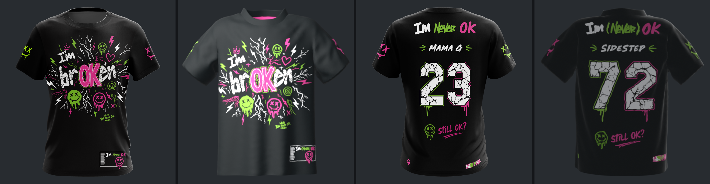

# Jersey Vision

3D garment models whose **UV map is the sewing template** used to cut and print the real shirts,
plus **Jersey 3D Proof**, a three.js tool for placing artwork on the template and checking it on
the model. New garment types (long sleeve, raglan, tank, hockey, baseball, …) are added by writing
a `garment.json` spec and running the pipeline. The `garment-model` skill walks Claude through it.



## Quick start

```bash
npm install
npm run serve            # http://localhost:5173/web/  (garment picker when there is more than one)
```
- `npm test` runs a headless end-to-end smoke test of the viewer (Playwright; `npx playwright install chromium` once).
- `npm run build:artifact` writes `dist/jersey-proof.html`: one self-contained page with every registered
  garment inlined (the version published as a Claude artifact).
- `python pipeline/tests/run_engine_tests.py`: engine regression checks (no Blender needed).

## Repository layout

| Path | What it is |
|---|---|
| `garments/<slug>/garment.json` | the garment spec: pieces, corners, seams, placement, finishing, fit |
| `garments/<slug>/template.png` | the sewing template = **the UV space** (`template_source.svg/pdf` if vector) |
| `garments/<slug>/references/` | mockup images used for shape and side checks |
| `garments/<slug>/out/` | `model.glb`, `model_untextured.glb`, `model.blend`, `texture.png`, `manifest.json`, renders |
| `garments/<slug>/build/` | intermediates and check images (git-ignored, regenerable) |
| `garments/index.json` | garments listed in the viewer |
| `pipeline/gk.py` + `pipeline/garmentkit/` | Python half: inspect, pattern, seam map, mannequin, texture, check, register |
| `pipeline/blender/` | Blender half: `sim.py`, `finish.py`, `export.py`, `run.py` (all), `preview.py` |
| `pipeline/tests/` | engine tests and fixtures (a synthetic tank top) |
| `web/` | Jersey 3D Proof (`index.html`, single file), dev server, artifact build, smoke test |
| `.claude/skills/garment-model/` | the skill: workflow, spec reference, garment-type guide, troubleshooting |

## Building a garment

```bash
pip install -r pipeline/requirements.txt
python pipeline/gk.py new raglan-ls --template path/to/template.png --refs front.png back.png --name "Raglan long sleeve"
python pipeline/gk.py inspect raglan-ls      # pieces + corner candidates -> build/inspect*.png
#   ... write garments/raglan-ls/garment.json (see the skill's spec reference and garments/crew-tee) ...
python pipeline/gk.py prep raglan-ls         # pattern + seam map (checkpoint) + mannequin + sample print
blender --background --python pipeline/blender/run.py -- raglan-ls
python pipeline/gk.py check raglan-ls        # UVs, scale, material -> build/uv_check.png
python pipeline/gk.py compare raglan-ls      # references vs renders -> build/compare.png
python pipeline/gk.py register raglan-ls     # add to the viewer
```
How it works: each piece is triangulated in template pixels (so UV = template position) with
matching vertex counts along every seam. The pieces are wrapped around a mannequin sized from the
pattern and sewn together by Blender's cloth simulation, using the flat pattern as the cloth's rest
shape so the fabric keeps the template's real dimensions. Seams are then welded and smoothed, and
hem turn-ups, collars/bindings and inside labels are added.

## Model conventions (all garments)

- glTF, Y-up, metres; **front faces +Z**, wearer's left is +X; centred on the origin.
- One mesh, one material (double-sided), UV set `TEXCOORD_0`.
- Template pixel `(px, py)` → UV `((px + 0.5) / W, (py + 0.5) / H)` in glTF (v top-down). Textures made from
  the template must use `flipY = false`:

```js
const gltf = await new GLTFLoader().loadAsync('garments/crew-tee/out/model.glb');
const garment = gltf.scene.getObjectByName('Jersey');     // export.object_name in garment.json
const tex = await new THREE.TextureLoader().loadAsync('design.png');   // full template artboard
tex.flipY = false;
tex.colorSpace = THREE.SRGBColorSpace;
garment.material.map = tex;
garment.material.needsUpdate = true;
```
Export artwork on the full template artboard (any resolution at the template's aspect ratio) and
bleed it 3–5 mm past every cut line.

## Garments

| Slug | Type | Notes |
|---|---|---|
| `crew-tee` | set-in short sleeve, crew neck | sleeve hems turned up; neck rib folds to 30 mm (lower half outside); inner neck tape runs ~80 mm along each shoulder seam (assumption) |

## Open questions (crew-tee)
Does the template include seam allowance (none is removed)? Which half of the neck strip faces out?
